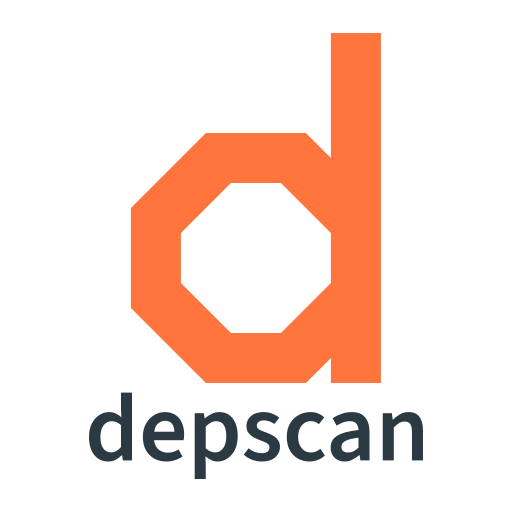

# Introduction

OWASP dep-scan audits the software you ship for what can actually hurt it: known vulnerabilities in your dependencies and their transitive tree, malicious packages, unsafe native code, weak binary hardening, risky supply-chain practices and licence limits. It scans source repositories, container images, binaries and package lists, and it runs everything locally: the matching happens against a database you hold, and your code never leaves the machine.



[](https://github.com/cdxgen/cdxgen) [](https://github.com/owasp-dep-scan/dep-scan/actions/workflows/pythonpublish.yml)

## What dep-scan 7 does that a plain vulnerability scanner does not

A plain scanner matches package names against an advisory list. dep-scan 7 goes further on three counts.

Every result is one finding shape, whatever produced it: an advisory match, a memory-safety defect, a binary-hardening gap, a licence conflict or a malicious package. Each finding carries its fix, its references, the tool that produced it, and an exploitability assessment on four axes: presence (is the vulnerable code in what you ship), reach (can your code reach it), exposure (can untrusted input get there) and barrier (what stands in the way). The axes are filled only from evidence the scan collected, and the grade names the rule that produced it, so a disputed grade is a question about one row of the rule table, not a mystery number.

A scan is also honest about what it did not check. "Assessed and nothing found" and "not assessed" are different states in every output, because an analyzer that did not run is not a clean result. A missing tool, a timeout or a gap in the database shows up in the scan manifest and the report, never as a silent zero.

Here is one finding from a real scan of a Go service (`GHSA-jq35-85cj-fj4p`, an advisory against the `github.com/docker/docker` module, whose client code the service calls), trimmed to the fields that matter:

```json
{
  "category": "vulnerability",
  "rule": "GHSA-jq35-85cj-fj4p",
  "severity": "medium",
  "coverage": { "state": "assessed" },
  "components": ["pkg:golang/github.com/docker/docker@v24.0.5%2Bincompatible"],
  "exploitability": {
    "axes": { "presence": "proven", "reach": "likely", "exposure": "not_assessed", "barrier": "not_assessed" },
    "grade": "moderate",
    "rule": "reached",
    "unassessed": ["exposure", "barrier"],
    "sources": { "reach": ["golem"], "presence": ["vdb", "cdxgen", "golem"] },
    "witness": "ev-ddf5445675cd9b7e"
  },
  "fix": { "fixed_versions": ["24.0.7"] },
  "producer": { "name": "dep-scan", "version": "7.0.0a3" }
}
```

The finding names its witness record in the scan's evidence store, and that record carries the call path the golem analyzer traced, golem's own caveats about the run, and the file and line of each hop:

```json
{
  "id": "ev-ddf5445675cd9b7e",
  "kind": "reached-flow",
  "producer": { "name": "golem", "version": "4.3.1" },
  "caveats": [
    { "kind": "budget", "detail": "golem's slice reachability came back partial (no-entry-roots)" }
  ],
  "path": [
    { "file": "github.com/docker/docker@v24.0.5+incompatible/client/hijack.go", "line": 62, "method": "(*github.com/docker/docker/client.Client).setupHijackConn" },
    { "line": 683, "method": "(*net/http/httputil.ClientConn).Do", "symbol": "fmt.Fprintf" }
  ]
}
```

The same scan directory answers a person (the console tables), a CI job (`--format json`, documented exit codes) and a coding agent (the `depscan mcp` server and the agent plugin) without anyone re-running anything.

## Install

Install cdxgen and dep-scan:

```bash
npm install -g @cdxgen/cdxgen
pip install owasp-depscan
```

The first scan downloads the vulnerability database. Pick a flavor with `depscan vdb download`: `--flavor app-only` for source scans, the default `full` when you also scan containers and OS packages. Two commands and about one sentence of choice; the flavor matrix and the sizes are on [the vulnerability database page](https://depscan.readthedocs.io/start/vulnerability-database/).

```bash
depscan vdb download --flavor app-only
```

Prefer not to install Python at all? Use the container image, a standalone binary, or Homebrew:

```bash
# Container image
docker run --rm -v $PWD:/app ghcr.io/owasp-dep-scan/dep-scan depscan scan /app --reports-dir /app/reports

# Homebrew (installs the standalone binary, cdxgen bundled)
brew tap owasp-dep-scan/tap
brew install dep-scan
```

Standalone binaries for Linux, musl, macOS and Windows are attached to each [release](https://github.com/owasp-dep-scan/dep-scan/releases), each with a `.sha256` file. The install methods and what each carries are compared on [the installation page](https://depscan.readthedocs.io/start/installation/).

## The first three commands

Scan a project. For Java and the other JVM languages, JavaScript and TypeScript, Python, PHP and Ruby, call-level reachability needs cdxgen's research BOM profile for the source slicing (`--bom-profile` defaults to `generic`), so pass it when you want call-level answers, or use `--profile research`, which also adds the license and supply-chain checks. For Go, Rust, Kotlin and .NET, dep-scan runs its own analyzers on a typed scan such as `-t go`, or on a universal scan with `--profile deep`:

```bash
depscan scan ./my-project --reports-dir ./reports --bom-profile research
```

Everything lands in one scan directory: the BOM, the VDR, `depscan.findings.json`, the evidence store and `depscan.manifest.json`, which records what ran, what did not and why. Read the scan back without re-running it:

```bash
depscan report ./reports
```

Before debugging anything on a new machine, ask what a scan can rely on here:

```bash
depscan doctor
```

The command reports every tool, the database state and, for each capability, whether it can run here and why not.

Where to go next:

- [the first scan](https://depscan.readthedocs.io/start/first-scan/): what the scan writes and how to read it
- [CI and agents](https://depscan.readthedocs.io/integrate/ci/): profiles, exit codes and gating in CI
- [the MCP server](https://depscan.readthedocs.io/integrate/mcp/) and [the agent plugin](https://depscan.readthedocs.io/integrate/agent-plugin/): the same results for a coding agent
- [container images](https://depscan.readthedocs.io/targets/container-images/) and [binaries](https://depscan.readthedocs.io/targets/binaries/): scanning what you ship rather than what you edit
- [migrating from v6](https://depscan.readthedocs.io/upgrade/migrate-v6-to-v7/): every removed option and its replacement

Lessons that walk a real project end to end are under [Tutorials](https://depscan.readthedocs.io/lessons/01-node-source-reachability/) in the documentation.

## Command help

The verbs and the full list of scan options (`depscan --help`):

```text
usage: depscan [-h] {scan,report,vdb,doctor,schema,config,serve,mcp,validate,version,help} ...

Fully open-source security and license audit for application dependencies and container images based on known vulnerabilities and advisories.

positional arguments:
  {scan,report,vdb,doctor,schema,config,serve,mcp,validate,version,help}
    scan                Scan a project, BOM, purl or container image for vulnerabilities.
    report              Render the console tables and explanations of a saved scan.
    vdb                 Download and inspect the vdb vulnerability database.
    doctor              Report the tools, data and capabilities a scan can use here.
    schema              Print the published finding schemas.
    config              Show the effective scan options or write a config file.
    serve               Run depscan as a server.
    mcp                 Run the MCP server over stdio for agents and MCP clients.
    validate            Validate CSAF VEX or CycloneDX VDR/VEX documents against their schema.
    version             Print the dep-scan version, with tool versions as JSON.
    help                Show the top-level help, or one verb's help.

options:
  -h, --help            show this help message and exit

Visit https://github.com/owasp-dep-scan/dep-scan to learn more
```

The scan verb's own options are on [the usage page](https://depscan.readthedocs.io/reference/cli/), kept generated from the code so they cannot drift from it.

## License

MIT License

This project was donated to the OWASP Foundation in August 2023 by AppThreat Ltd.

## Funding

This project is funded through [NGI Zero Core](https://nlnet.nl/core), a fund established by [NLnet](https://nlnet.nl) with financial support from the European Commission's [Next Generation Internet](https://ngi.eu) program. Learn more at the [NLnet project page](https://nlnet.nl/project/OWASP-dep-scan).

[](https://nlnet.nl)
[](https://nlnet.nl/core)
