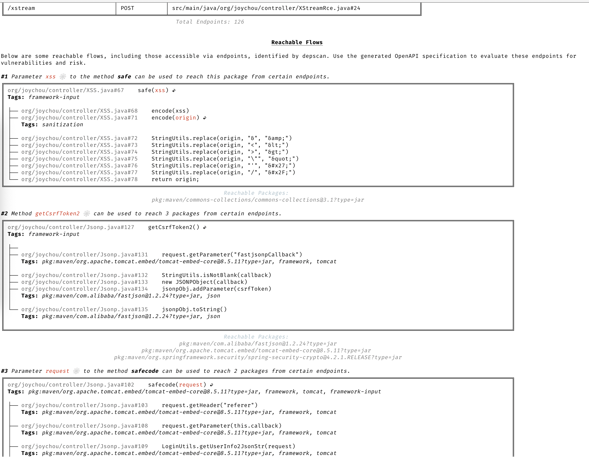
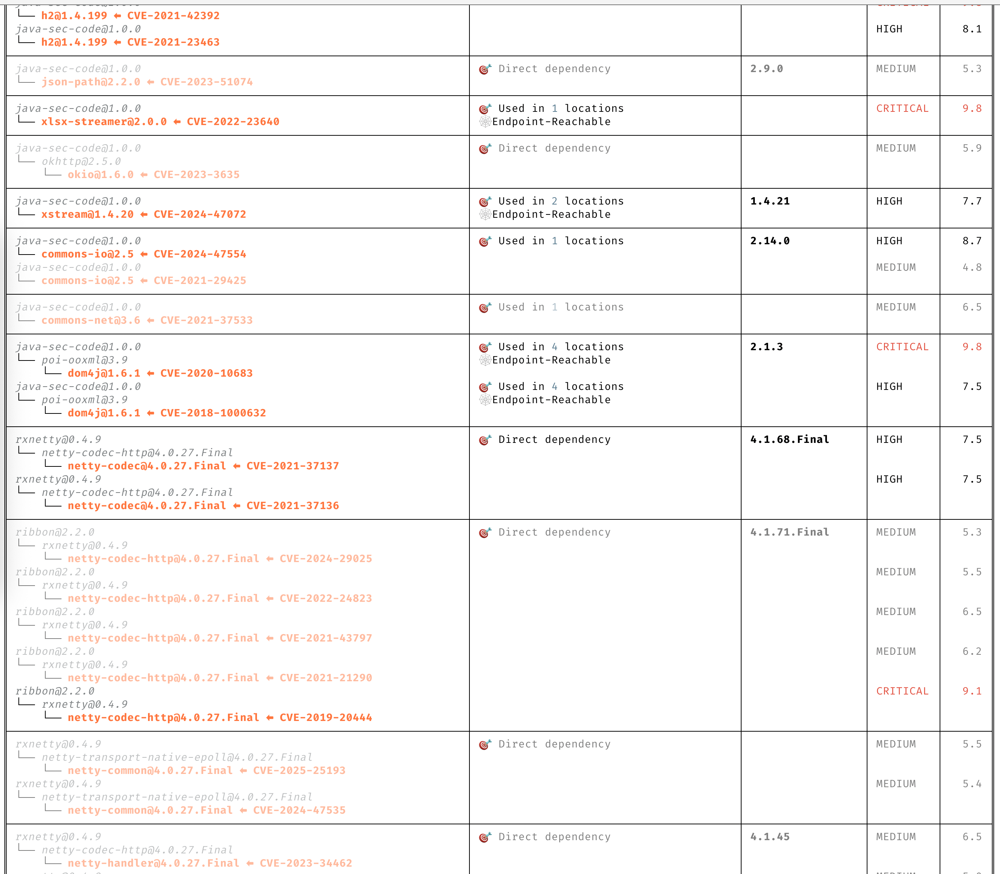
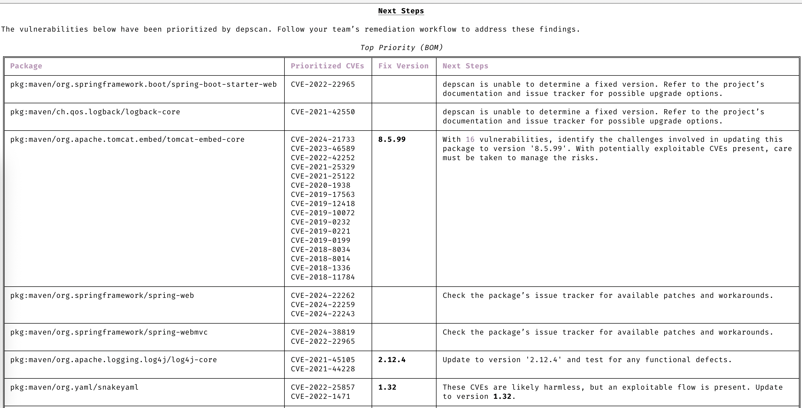
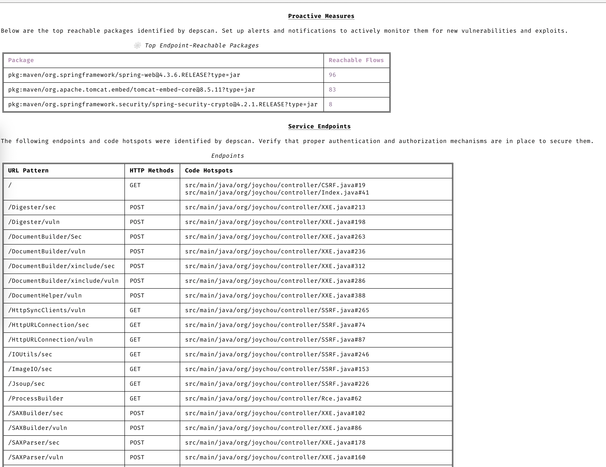

# Introduction

OWASP dep-scan is a next-generation security and risk audit tool based on known vulnerabilities, advisories, and license limitations for project dependencies. Both local repositories and container images are supported as the input, and the tool is ideal for integration with ASPM/VM platforms and in CI environments.


[](https://github.com/cdxgen/cdxgen) [](https://github.com/owasp-dep-scan/dep-scan/actions/workflows/pythonpublish.yml)

## Contents

- [Features](#features)
    - [Precise reachable data-flows](#precise-reachable-data-flows)
    - [Reachability matrix](#reachability-matrix)
    - [Rust reachability (via rusi)](#rust-reachability-via-rusi)
    - [Go reachability (via golem)](#go-reachability-via-golem)
    - [.NET reachability (via dosai)](#net-reachability-via-dosai)
    - [JVM, JavaScript, Python, and PHP reachability (via atom)](#jvm-javascript-python-and-php-reachability-via-atom)
    - [Vulnerability Data sources](#vulnerability-data-sources)
    - [Linux distros](#linux-distros)
- [Quick Start](#quick-start)
    - [Scanning projects locally (Python version)](#scanning-projects-locally-python-version)
    - [Homebrew (macOS and Linux)](#homebrew-macos-and-linux)
    - [Standalone binaries (no Python or Node.js required)](#standalone-binaries-no-python-or-nodejs-required)
    - [Scanning containers locally (Python version)](#scanning-containers-locally-python-version)
    - [Scanning projects locally (Docker container)](#scanning-projects-locally-docker-container)
    - [Server mode](#server-mode)
- [Coding agents](https://depscan.readthedocs.io/agent-plugin)
- [Local development](#local-development)
- [Documentation (depscan.readthedocs.io)](https://depscan.readthedocs.io)
- [License](#license)

## Features

- Scan most application code (local repos, Linux container images, Kubernetes manifests, and OS) to identify known CVEs with prioritization
- Perform advanced reachability analysis for multiple languages (see the [reachability matrix](#reachability-matrix) below)
- Package vulnerability scanning is performed locally and is quite fast. No server is used
- Generate Software Bill-of-Materials (SBOM) with Vulnerability Disclosure Report (VDR) information
- Generate a Common Security Advisory Framework (CSAF) 2.0/2.1 VEX document (check out the [CSAF Readme](contrib/CSAF_README.md))
- Perform deep packages risk audit for dependency confusion attacks and maintenance risks (see the [risk audit docs](https://depscan.readthedocs.io/adv-usage#package-risk-audit))

### Precise Reachable data-flows

Detailed data flows to identify both reachable and non-reachable paths in your application based on the full context.



### Reachability matrix

dep-scan computes reachability for seven language ecosystems through four slicers. A vulnerable package whose code is actually on an executed path is marked **Reachable**, while a package that is merely declared in the BOM but never called is not. Every slicer feeds the same shared, purl-keyed reachability engine, so the behavior is uniform across languages. Reachability is on by default (`--reachability-analyzer FrameworkReachability`); `SemanticReachability` additionally attributes reached services, endpoints, and post-build (binary/container) reachability.

| Language / ecosystem               | Reachability engine                                   | Default analyzer        |
| ---------------------------------- | ----------------------------------------------------- | ----------------------- |
| Java / JVM (Groovy, Kotlin, Scala) | [atom](https://github.com/AppThreat/atom)             | `FrameworkReachability` |
| JavaScript / TypeScript            | atom                                                  | `FrameworkReachability` |
| Python                             | atom                                                  | `FrameworkReachability` |
| PHP                                | atom                                                  | `FrameworkReachability` |
| Rust                               | [rusi](https://github.com/cdxgen/cdxgen-plugins-bin)  | `FrameworkReachability` |
| Go                                 | [golem](https://github.com/cdxgen/cdxgen-plugins-bin) | `FrameworkReachability` |
| .NET (C#, VB, F#, R)               | [dosai](https://github.com/owasp-dep-scan/dosai)      | `FrameworkReachability` |

For the concepts behind reachability and prioritization, read the [reachability model](https://depscan.readthedocs.io/concepts/reachability-model) and [prioritization](https://depscan.readthedocs.io/concepts/prioritization) chapters. For per-language worked examples, see the [Language Guides](https://depscan.readthedocs.io/languages/rust-reachability). For the compliance story (VDR and CSAF VEX), see the [VDR guide](https://depscan.readthedocs.io/output/vdr-guide) and the [CSAF VEX guide](https://depscan.readthedocs.io/output/vex-csaf-guide).

Reachability is on by default: dep-scan asks cdxgen for its research BOM profile, which writes the slices the analyzers read. The commands below are enough to get started; the per-language guides cover binary resolution, backend and network safety, restore requirements, and worked examples on the in-repo fixtures.

**Rust (rusi).** cdxgen runs [rusi](https://github.com/cdxgen/cdxgen-plugins-bin) and persists its report, which dep-scan converts into the shared pipeline, so a crate that is actually called (for example `time::now()` for RUSTSEC-2020-0071) is Reachable while one merely present is not. See the [Rust reachability guide](https://depscan.readthedocs.io/languages/rust-reachability).

```bash
depscan scan ./my-rust-app -o ./reports --bom-profile research
```

**Go (golem).** dep-scan invokes [golem](https://github.com/cdxgen/cdxgen-plugins-bin) directly for Go projects (needs `go` on `PATH`), marking a module Reachable when its functions are on a traced path. golem runs with cgo off, so packages that need cgo are not loaded and their reachability is missing; pass `--go-analyzer-cgo` for trusted input. Use `--go-analyzer-network offline` for untrusted repos with a warm module cache. See the [Go reachability guide](https://depscan.readthedocs.io/languages/go-reachability).

```bash
depscan scan ./my-go-app -o ./reports -t go
```

**.NET (dosai).** cdxgen runs [dosai](https://github.com/owasp-dep-scan/dosai), which emits an explicit per-package reachability verdict (`PackageReachability` with `ReachabilityKind` and `Confidence`) that dep-scan treats as authoritative, so a NuGet package actually called (for example `JsonConvert.DeserializeObject` on a controlled input) is Reachable. Scan a restored tree for versioned purls. See the [.NET reachability guide](https://depscan.readthedocs.io/languages/dotnet-reachability).

```bash
depscan scan ./my-dotnet-app -o ./reports -t dotnet
```

**JVM, JavaScript/TypeScript, Python, and PHP (atom).** These four ecosystems share the [atom](https://github.com/AppThreat/atom) slicer, which builds a language-agnostic intermediate representation and performs static slicing. See the [JVM, JS, Python, and PHP reachability guide](https://depscan.readthedocs.io/languages/jvm-js-python-php-reachability).

```bash
depscan scan ./my-java-app --bom-profile research -t java -o ./reports --explain
```

To move beyond framework-forward reachability to endpoint, service, and post-build tiers, pass `--reachability-analyzer SemanticReachability` with a directory of lifecycle BOMs as the target and `--target-kind bom-dir`. See the [semantic reachability guide](https://depscan.readthedocs.io/analyzers/semantic-reachability).

### Clear insights about CVEs

Understand CVEs clearly without having to read through the description.



### Automatic prioritization

Only focus on CVEs that need your attention.



### Stay proactive

Always stay a step ahead with advanced vulnerability and exploit prediction.



### Vulnerability Data sources

- OSV
- NVD
- GitHub
- NPM
- Linux [vuln-list](https://github.com/appthreat/vuln-list)

### Linux distros

- AlmaLinux
- Debian
- Alpine
- Amazon Linux
- Arch Linux
- RHEL/CentOS
- Rocky Linux
- Ubuntu
- OpenSUSE/SLES
- Photon
- Chainguard
- Wolfi OS

## Quick Start

dep-scan is ideal for use during continuous integration (CI) and as a local development tool.

### Scanning projects locally (Python version)

```bash
sudo npm install -g @cdxgen/cdxgen@13.8.0
# Normal version recommended for most users (MIT)
pip install owasp-depscan

# For a full version with all extensions and server mode (Multiple Licenses)
pip install owasp-depscan[all]
```

This would install two commands called `cdxgen` and `depscan`.

You can invoke the scan command directly with the various options.

```bash
cd <project to scan>
depscan scan $PWD --reports-dir $PWD/reports
```

The verbs and the full list of scan options are below (`depscan --help`):

```text
usage: depscan [-h]
               {scan,report,vdb,doctor,schema,config,serve,validate,version,help} ...

Fully open-source security and license audit for application dependencies and
container images based on known vulnerabilities and advisories.

positional arguments:
  {scan,report,vdb,doctor,schema,config,serve,validate,version,help}
    scan                Scan a project, BOM, purl or container image for
                        vulnerabilities.
    report              Render the console tables and explanations of a saved
                        scan.
    vdb                 Download and inspect the vdb vulnerability database.
    doctor              Report the tools, data and capabilities a scan can use
                        here.
    schema              Print the published finding schemas.
    config              Show the effective scan options or write a config
                        file.
    serve               Run depscan as a server.
    validate            Validate CSAF VEX or CycloneDX VDR/VEX documents
                        against their schema.
    version             Print the dep-scan version, with tool versions as
                        JSON.
    help                Show the top-level help, or one verb's help.

options:
  -h, --help            show this help message and exit

Visit https://github.com/owasp-dep-scan/dep-scan to learn more
```

The scan verb's own options (`depscan scan --help`):

```text
usage: depscan scan [-h]
                    [--target-kind {purl,git,container,bom,bom-dir,binary,android,ios,source,firmware}]
                    [--checks CHECKS]
                    [--profile {quick,ci,deep,research,offline}]
                    [--bom-profile {appsec,research,operational,threat-modeling,license-compliance,generic,machine-learning,ml,deep-learning,ml-deep,ml-tiny}]
                    [--exclude-type TYPE] [--format {text,json}]
                    [--config CONFIG] [--no-banner] [-o REPORTS_DIR] [--debug]
                    [-q | --explain] [--csaf] [--csaf-version {2.0,2.1}]
                    [--custom-data CUSTOM_DATA]
                    [--report-template REPORT_TEMPLATE]
                    [--report-name REPORT_NAME]
                    [--lifecycle {pre-build,build,post-build} [{pre-build,build,post-build} ...]]
                    [--technique {auto,source-code-analysis,binary-analysis,manifest-analysis,hash-comparison,instrumentation,filename} [{auto,source-code-analysis,binary-analysis,manifest-analysis,hash-comparison,instrumentation,filename} ...]]
                    [--bom-engine {auto,CdxgenGenerator,CdxgenServerGenerator,CdxgenImageBasedGenerator,BlintGenerator} |
                    --vulnerability-analyzer {auto,VDRAnalyzer,LifecycleAnalyzer}]
                    [--reachability-analyzer {off,FrameworkReachability,SemanticReachability}]
                    [--spec-version SPEC_VERSION] [--cdxgen-args CDXGEN_ARGS]
                    [--cdxgen-server CDXGEN_SERVER]
                    [--rust-analyzer-backend {stable,compiler}]
                    [--go-analyzer-network {auto,offline}] [--go-analyzer-cgo]
                    [--dotnet-analyzer-mode {source,assembly,auto}]
                    [--no-suggest] [--fail-on-error]
                    [-t PROJECT_TYPE [PROJECT_TYPE ...]]
                    [--private-ns PRIVATE_NS] [--deep] [--fuzzy-search]
                    [--search-order {purl,pcu,cpe,cpu,url}]
                    [--severity {low,medium,high,critical}] [--malware-only]
                    [--vdb-flavor {full,app-only,app-extended,app-10y,app-10y-extended}]
                    [--vdb-scope {app,app+os}] [--vdb-time {2y,default,10y}]
                    [--vdb-extended] [--vdb-compression {xz,zst}]
                    [--vdb-distro {alpine,debian,redhat,alma,rocky,ubuntu}]
                    [--vdb-image VDB_IMAGE] [--no-universal] [--no-vuln-table]
                    [--explanation-mode {Endpoints,EndpointsAndReachables,NonReachables,LLMPrompts}]
                    [--annotate]
                    [target ...]

positional arguments:
  target                What to scan: a source directory, git URL, container
                        image reference, BOM file, BOM directory, purl or
                        binary. The kind is detected; pass --target-kind to
                        force one. Multiple targets run one scan each.

options:
  -h, --help            show this help message and exit
  --target-kind {purl,git,container,bom,bom-dir,binary,android,ios,source,firmware}
                        Force the kind of every target instead of detecting
                        it. firmware is accepted only to be refused: it has no
                        inventory path in this version.
  --checks CHECKS       Comma-separated list of checks to run: all,
                        vulnerabilities, reachability, license, supply-chain,
                        binary, memory-safety, mobile, code, crypto. An
                        explicit list defines the whole optional set;
                        vulnerabilities always runs.
  --profile {quick,ci,deep,research,offline}
                        Scan profile: quick (vulnerabilities only), ci
                        (vulnerabilities and reachability, no explanations),
                        deep (adds license and supply-chain with semantic
                        reachability), research (deep plus cdxgen's research
                        BOM profile), offline (no database download, no remote
                        cdxgen). Explicit options win over the profile.
  --bom-profile {appsec,research,operational,threat-modeling,license-compliance,generic,machine-learning,ml,deep-learning,ml-deep,ml-tiny}
                        Profile to use while generating the BOM. For granular
                        control, use the arguments --bom-engine,
                        --vulnerability-analyzer, or --reachability-analyzer.
  --exclude-type TYPE   Project type dropped from the detected list before any
                        stage runs, so no inventory or scan runs for it (an
                        excluded os or docker type stops the OS and container
                        scans), and passed to cdxgen as a repeated --exclude-
                        type argument so the BOM contents are filtered the
                        same way. Repeatable; comma-separated values are
                        accepted.
  --format {text,json}  text for people, json for scripts (default: text)
  --config CONFIG       Path to the configuration file. Default:
                        $PWD/.config/depscan.toml
  --no-banner           Do not display the logo and donation banner. Please
                        make a donation to OWASP before using this argument.
  -o, --reports-dir REPORTS_DIR
                        Reports directory
  --debug               Run depscan in debug mode.
  -q, --quiet           Makes depscan quiet.
  --explain             Makes depscan to explain the various analysis. Useful
                        for creating detailed reports.
  --csaf                Generate a OASIS CSAF VEX document
  --csaf-version {2.0,2.1}
                        CSAF schema version to target (default: 2.1). CSAF 2.1
                        retains CVSS v4 scores; 2.0 drops them because the
                        schema has no cvss_v4 slot.
  --custom-data CUSTOM_DATA
                        Path to directory containing custom vulnerability data
                        (JSON/YAML/TOML) to override/augment results.
  --report-template REPORT_TEMPLATE
                        Jinja template file used for rendering a custom report
  --report-name REPORT_NAME
                        Filename of the custom report written to the
                        --reports-dir
  --lifecycle {pre-build,build,post-build} [{pre-build,build,post-build} ...]
                        Product lifecycle for the generated BOM. Multiple
                        values allowed.
  --technique {auto,source-code-analysis,binary-analysis,manifest-analysis,hash-comparison,instrumentation,filename} [{auto,source-code-analysis,binary-analysis,manifest-analysis,hash-comparison,instrumentation,filename} ...]
                        Analysis technique to use for BOM generation. Multiple
                        values allowed.
  --bom-engine {auto,CdxgenGenerator,CdxgenServerGenerator,CdxgenImageBasedGenerator,BlintGenerator}
                        BOM generation engine to use. Defaults to automatic
                        selection based on project type and lifecycle.
  --vulnerability-analyzer {auto,VDRAnalyzer,LifecycleAnalyzer}
                        Vulnerability analyzer to use. Defaults to automatic
                        selection based on bom_dir argument.
  --reachability-analyzer {off,FrameworkReachability,SemanticReachability}
                        Reachability analyzer to use. Default
                        FrameworkReachability.
  --spec-version SPEC_VERSION
                        CycloneDX specification version to request from
                        cdxgen. Choices: 1.4, 1.5, 1.6, 1.7, 2.0. Defaults to
                        1.6 (1.7 is not yet supported by Dependency-Track and
                        some other consumers).
  --cdxgen-args CDXGEN_ARGS
                        Additional arguments to pass to cdxgen
  --cdxgen-server CDXGEN_SERVER
                        cdxgen server url. Eg: http://cdxgen:9090
  --rust-analyzer-backend {stable,compiler}
                        rusi (Rust Source Inspector) backend for Rust
                        reachability. ``stable`` (default) is syn-based
                        parsing with no cargo/rustc build and is safe on
                        untrusted repos. ``compiler`` embeds nightly rustc and
                        builds the target for higher fidelity -- only use on
                        trusted input (see rusi THREAT_MODEL). Implied by
                        --deep for Rust projects. Set DEPSCAN_RUSI_BINARY to
                        point at a non-PATH rusi binary.
  --go-analyzer-network {auto,offline}
                        Network mode for golem (Go Source Inspector)
                        reachability. golem runs with cgo off, so packages
                        that need cgo are not loaded and their reachability is
                        missing; pass --go-analyzer-cgo to enable cgo for
                        trusted input. ``auto`` (default) allows golem's
                        package loader to download missing modules per the
                        user's Go env (GOFLAGS=-mod=readonly is still set to
                        prevent go.mod rewrites). ``offline`` sets GOPROXY=off
                        to forbid all downloads -- requires a warm module
                        cache (GOMODCACHE). Set DEPSCAN_GOLEM_BINARY to point
                        at a non-PATH golem binary.
  --go-analyzer-cgo     Allow cgo while golem loads Go packages. Default is
                        cgo off: packages that need cgo are not loaded and
                        their reachability is missing. With this flag the C
                        compiler runs with flags taken from the scanned code
                        and its dependencies, so use it only for input you
                        trust. Can also be enabled with
                        DEPSCAN_GO_ANALYZER_CGO.
  --dotnet-analyzer-mode {source,assembly,auto}
                        dosai (Dotnet Source and Assembly Inspector) analysis
                        mode for .NET reachability. ``auto`` (default)
                        inspects source when a source tree is present and
                        falls back to assembly inspection for bin/.nupkg-only
                        inputs. ``source`` forces Roslyn-based C#/VB/F# source
                        inspection; ``assembly`` forces Reflection-based
                        .dll/.exe inspection. Pattern packs default to
                        ``all``. dosai requires a .NET runtime (or a self-
                        contained ``-full`` binary). Set DOSAI_CMD to point at
                        a non-PATH dosai binary. dep-scan does NOT run
                        ``dotnet restore``; a restored tree yields the best
                        versioned NuGet purls.
  --no-suggest          Disable suggest mode
  --fail-on-error       Abort the scan with a non-zero exit code instead of
                        silently degrading. Passed through to cdxgen so
                        extractor failures fail BOM generation, and applied to
                        blint, rusi, golem, and dosai failures, unreadable
                        reachability reports, empty slices, and empty package
                        lists.
  -t, --type PROJECT_TYPE [PROJECT_TYPE ...]
                        Override project types if auto-detection is incorrect.
                        Multiple values supported.
  --private-ns PRIVATE_NS
                        Private namespace to use while performing oss risk
                        audit. Private packages should not be available in
                        public registries by default. Comma separated values
                        accepted.
  --deep                Perform deep scan by passing this --deep argument to
                        cdxgen. Useful while scanning docker images and OS
                        packages.
  --fuzzy-search        Perform fuzzy search by creating variations of package
                        names. Use this when the input SBOM lacks a PURL.
  --search-order {purl,pcu,cpe,cpu,url}
                        Attributes to use while searching for vulnerabilities.
                        Default: PURL, CPE, URL (pcu).
  --severity {low,medium,high,critical}
                        Minimum severity threshold to report (low, medium,
                        high, critical). Only advisories at or above this
                        severity are returned. depscan applies this floor to
                        the final VDR on any database; on the extended vdb
                        (VDB_INCLUDE_METADATA) it is additionally pushed down
                        into the search for speed. Findings with no rated
                        severity are kept.
  --malware-only        Report only malware advisories (MAL-*). Works on the
                        default vdb because is_malware is always populated via
                        the MAL- fallback.
  --no-universal        Depscan would attempt to perform a single universal
                        scan instead of individual scans per language type.
  --no-vuln-table       Do not print the table with the full list of
                        vulnerabilities. This can help reduce console output.
  --explanation-mode {Endpoints,EndpointsAndReachables,NonReachables,LLMPrompts}
                        Style of explanation needed. Defaults to Endpoints and
                        Reachables.
  --annotate            Include the generated text VDR report as an
                        annotation. Defaults to true when explain is enabled;
                        false otherwise.

vulnerability database selection:
  Select which published vdb database the scan downloads. These can also be
  persisted in the depscan config file (e.g. vdb_flavor = "app-only"). An
  explicit VDB_DATABASE_URL env pin always wins. The `depscan vdb download`
  command shares the same options for pre-fetching.

  --vdb-flavor {full,app-only,app-extended,app-10y,app-10y-extended}
                        Which published database flavor to use: 'full'
                        (app+OS), 'app-only' (application ecosystems, NVD
                        2020+), 'app-extended' (adds metadata tables for
                        severity, text, alias, reference, symbol and date
                        search), 'app-10y' (NVD 2016+), 'app-10y-extended'
                        (both). Default: full.
  --vdb-scope {app,app+os}
                        Deprecated alias for --vdb-flavor: 'app' maps to app-
                        only (or app-extended/app-10y/app-10y-extended with
                        the other deprecated options), 'app+os' to full.
                        Default: app+os.
  --vdb-time {2y,default,10y}
                        Deprecated alias for --vdb-flavor: '10y' selects a
                        10-year flavor; '2y' has no v7 equivalent and is
                        rejected. Default: default.
  --vdb-extended        Deprecated alias selecting the metadata flavor (app-
                        extended or app-10y-extended), needed for severity,
                        text, alias, reference, symbol, and date search. Auto-
                        selected when --severity is set.
  --vdb-compression {xz,zst}
                        Compression format. 'xz' (tar.xz) always works; 'zst'
                        (zstd) is faster to decompress but needs a zstd
                        decompressor. Default: xz.
  --vdb-distro {alpine,debian,redhat,alma,rocky,ubuntu}
                        Rejected: vdb 7 publishes no per-distro complete
                        database. Pass --vdb-flavor full and scan the distro
                        packages, or fetch type shards with `depscan vdb
                        download`.
  --vdb-image VDB_IMAGE
                        Override the vdb image URL verbatim (bypasses the
                        resolver). Equivalent to setting VDB_DATABASE_URL.
```

### Homebrew (macOS and Linux)

Homebrew installs the [standalone binary](#standalone-binaries-no-python-or-nodejs-required) as `depscan` from the [OWASP dep-scan tap](https://github.com/owasp-dep-scan/homebrew-tap), with cdxgen bundled and no Python or Node.js needed. `brew trust` accepts the tap, which Homebrew requires before loading formulae from a third-party tap when `HOMEBREW_REQUIRE_TAP_TRUST` is set:

```bash
brew tap owasp-dep-scan/tap
brew trust --tap owasp-dep-scan/tap
brew install dep-scan
depscan scan $PWD --reports-dir $PWD/reports
```

### Standalone binaries (no Python or Node.js required)

Pre-built single-file executables are attached to each [GitHub release](https://github.com/owasp-dep-scan/dep-scan/releases). They bundle a matching [cdxgen](https://github.com/cdxgen/cdxgen) SEA binary, so BOM generation works out of the box without installing Python, Node.js, or cdxgen.

| Platform              | Architecture  | Asset                       |
| --------------------- | ------------- | --------------------------- |
| Linux (glibc)         | x86_64        | `depscan-linux-amd64`       |
| Linux (glibc)         | arm64         | `depscan-linux-arm64`       |
| Linux (musl / Alpine) | x86_64        | `depscan-linux-amd64-musl`  |
| Linux (musl / Alpine) | arm64         | `depscan-linux-arm64-musl`  |
| macOS                 | Apple silicon | `depscan-darwin-arm64`      |
| macOS                 | Intel         | `depscan-darwin-amd64`      |
| Windows               | x86_64        | `depscan-windows-amd64.exe` |

Each asset has a matching `.sha256` file for verification.

```bash
# Example: Linux x86_64
curl -LO https://github.com/owasp-dep-scan/dep-scan/releases/latest/download/depscan-linux-amd64
curl -LO https://github.com/owasp-dep-scan/dep-scan/releases/latest/download/depscan-linux-amd64.sha256
sha256sum -c depscan-linux-amd64.sha256
chmod +x depscan-linux-amd64
./depscan-linux-amd64 scan $PWD --reports-dir $PWD/reports
```

> [!NOTE]
> The macOS binaries are currently unsigned. On first run macOS Gatekeeper may block them; clear the quarantine attribute with `xattr -d com.apple.quarantine ./depscan-darwin-arm64` (or allow the binary under System Settings, Privacy & Security).

> [!NOTE]
> The vulnerability database is still downloaded on first run. Only cdxgen is bundled, not the vuln DB. Use the `depscan vdb download` command to select a specific database variant, for example `depscan vdb download --flavor app-only` for a smaller app-only database. See the [vulnerability database guide](https://depscan.readthedocs.io/vulnerability-database) for the full image matrix.

All standalone binaries bundle `blint`, but not its optional `nyxstone` disassembly backend (which has no wheels and no Windows support). Deep disassembly-based binary analysis is therefore unavailable in the standalone binaries; use the Python package (`pip install owasp-depscan[all]`) if you need it.

### Scanning containers locally (Python version)

Scan a Java project.

```bash
depscan scan <path> -o containertests -t java
```

Scan `latest` tag of the container `shiftleft/scan-slim`

```bash
depscan scan shiftleft/scan-slim -o containertests -t docker
```

Include `license` to the type to perform the license audit.

```bash
depscan scan shiftleft/scan-slim -o containertests -t docker license
```

You can also specify the image using the sha256 digest

```bash
depscan scan redmine@sha256:a5c5f8a64a0d9a436a0a6941bc3fb156be0c89996add834fe33b66ebeed2439e -o containertests -t docker
```

You can also save container images using docker or podman save command and pass the archive to depscan for scanning.

```bash
docker save -o /tmp/scanslim.tar shiftleft/scan-slim:latest
# podman save --format oci-archive -o /tmp/scanslim.tar shiftleft/scan-slim:latest
depscan scan /tmp/scanslim.tar -o reports -t docker
```

Refer to the docker tests under the GitHub action workflow for this repo for more examples.

### Scanning projects locally (Docker container)

`ghcr.io/owasp-dep-scan/dep-scan` container image can be used to perform the scan.

To scan with default settings

```bash
docker run --rm -v $PWD:/app ghcr.io/owasp-dep-scan/dep-scan depscan scan /app --reports-dir /app/reports
```

To scan with custom environment variables based configuration

```bash
docker run --rm \
    -e VDB_HOME=/db \
    -e GITHUB_TOKEN=<token> \
    -v /tmp:/db \
    -v $PWD:/app ghcr.io/owasp-dep-scan/dep-scan depscan scan /app --reports-dir /app/reports
```

In the above example, `/tmp` is mounted as `/db` into the container. This directory is then specified as `VDB_HOME` for caching the vulnerability information. This way the database can be cached and reused to improve performance.

### Server mode

dep-scan and cdxgen could be run in server mode. Use the included docker-compose file to get started.

```bash
git clone https://github.com/owasp-dep-scan/dep-scan
docker compose up
```

The bundled compose file sets `DEPSCAN_SERVER_API_KEY` to a development placeholder by default so the dep-scan service can bind to `0.0.0.0`. Override this value before exposing the service outside a local lab.

```bash
depscan serve --server-host 127.0.0.1 --server-port 7070
```

If you need to bind dep-scan to a non-local address, set an API key first:

```bash
export DEPSCAN_SERVER_API_KEY="change-this-before-production"
depscan serve --server-host 0.0.0.0 --server-port 7070
```

> [!IMPORTANT]
> dep-scan refuses to bind to a non-local address without either `DEPSCAN_SERVER_API_KEY` or an explicit opt-in via `DEPSCAN_SERVER_ALLOW_UNAUTHENTICATED_BIND=true`.

The server refuses cross-site browser requests (a `Sec-Fetch-Site` of `cross-site` or `same-site`, or an `Origin` that does not match `Host`). Without an API key it also accepts only `localhost`, `*.localhost`, IP addresses and the names in `DEPSCAN_SERVER_TRUSTED_HOST_NAMES` as the `Host` header, which stops DNS rebinding, and when it is reached by a name or address other than `localhost` or loopback, `path` and `url` must be sent in a JSON body.

Use the `/scan` endpoint to perform scans.

> [!NOTE]
> The `type` parameter is mandatory in server mode. When API key authentication is enabled, send the key using `X-API-Key` or `Authorization: Bearer <key>`.

- Scanning a local directory.
  Scanning an SBOM file (present locally).

```bash
curl \
  -H 'X-API-Key: dev-only-change-me' \
  --json '{"path": "/tmp/vulnerable-aws-koa-app/sbom_file.json", "type": "js"}' \
  http://127.0.0.1:7070/scan
```

- Scanning a GitHub repo.

```bash
curl \
  -H 'Authorization: Bearer dev-only-change-me' \
  --json '{"url": "https://github.com/HooliCorp/vulnerable-aws-koa-app", "type": "js"}' \
  http://127.0.0.1:7070/scan \
  -o app.vdr.json
```

- Uploading an SBOM file and generating results based on it.

```bash
curl -X POST \
  -H 'X-API-Key: dev-only-change-me' \
  -H 'Content-Type: multipart/form-data' \
  -F 'file=@/tmp/app/sbom_file.json' \
  http://127.0.0.1:7070/scan?type=js
```

## Local development

Setup uv by following the official [documentation](https://docs.astral.sh/uv/).

```shell
uv sync --all-extras --all-packages
uv run depscan --help
uv run pytest
uv run pyrefly check
```

Type checking uses [pyrefly](https://pyrefly.org) (configuration lives in
`[tool.pyrefly]` in `pyproject.toml`); the check is expected to report zero
errors.

### Local VDB setup

```shell
vdb --clean
vdb db refresh full --app-only
# To scan containers and OS images
# vdb db refresh full
```

### Scan local depscan

```shell
uv run depscan scan --config .config/depscan-dev.toml
```

This would automatically use the configuration specified in the local config [file](./.config/depscan.toml).

## Documentation

Full documentation is at [depscan.readthedocs.io](https://depscan.readthedocs.io). Key pages:

- [Supported languages and reachability matrix](https://depscan.readthedocs.io/supported-languages)
- [Reachability analysis](https://depscan.readthedocs.io/reachability-analysis) (hub)
    - [The reachability model](https://depscan.readthedocs.io/concepts/reachability-model)
    - [How dep-scan prioritizes](https://depscan.readthedocs.io/concepts/prioritization)
    - [SBOM and evidence](https://depscan.readthedocs.io/concepts/sbom-and-evidence)
    - Language guides: [Rust](https://depscan.readthedocs.io/languages/rust-reachability), [Go](https://depscan.readthedocs.io/languages/go-reachability), [.NET](https://depscan.readthedocs.io/languages/dotnet-reachability), [JVM/JS/Python/PHP](https://depscan.readthedocs.io/languages/jvm-js-python-php-reachability)
    - Analyzers: [Framework reachability](https://depscan.readthedocs.io/analyzers/framework-reachability), [Semantic reachability](https://depscan.readthedocs.io/analyzers/semantic-reachability)
- Output and compliance: [VDR guide](https://depscan.readthedocs.io/output/vdr-guide), [CSAF VEX guide](https://depscan.readthedocs.io/output/vex-csaf-guide)
- [Agent plugin for coding agents](https://depscan.readthedocs.io/agent-plugin), [MCP server](https://depscan.readthedocs.io/mcp), [Agents and scripts](https://depscan.readthedocs.io/agents), [Questions to skills](https://depscan.readthedocs.io/agent-skills-toolchain)
- [Customization through environment variables](https://depscan.readthedocs.io/env-var#customization-through-environment-variables)
- Advanced usage: [GitHub Security Advisory](https://depscan.readthedocs.io/adv-usage#github-security-advisory), [Suggest mode](https://depscan.readthedocs.io/adv-usage#suggest-mode), [Package Risk audit](https://depscan.readthedocs.io/adv-usage#package-risk-audit), [Live OS scan](https://depscan.readthedocs.io/adv-usage#live-os-scan), [License scan](https://depscan.readthedocs.io/adv-usage#license-scan), [Custom reports](https://depscan.readthedocs.io/adv-usage#custom-reports)

## License

MIT License

This project was donated to the OWASP Foundation in August 2023 by AppThreat Ltd.

## Funding

This project is funded through [NGI Zero Core](https://nlnet.nl/core), a fund established by [NLnet](https://nlnet.nl) with financial support from the European Commission's [Next Generation Internet](https://ngi.eu) program. Learn more at the [NLnet project page](https://nlnet.nl/project/OWASP-dep-scan).

[](https://nlnet.nl)
[](https://nlnet.nl/core)
