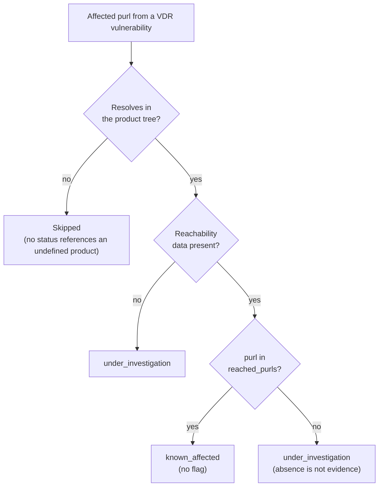

# Generating CSAF VEX with reachability

## What VEX is and why reachability changes it

A Vulnerability Exploitability eXchange (VEX) document tells a consumer, per product and per vulnerability, whether a given product is affected. Without reachability, a VEX statement can only say "a fixed version exists" or leave the status at "under investigation", which forces the consumer to treat every dependency CVE as potentially exploitable. dep-scan's VEX is different because it folds reachability into the assessment: dependencies whose code is observed on an executed path are marked `known_affected`, and every other affected dependency stays `under_investigation`. dep-scan does not write `known_not_affected` from reachability, because a dependency missing from a reached set was simply not observed, which does not show that its vulnerable code is outside the execute path; only a triage decision a person recorded, or a VEX document stated, sets it. The document helps a consumer put the observed, reachable dependency CVEs first.

dep-scan emits VEX as an OASIS Common Security Advisory Framework (CSAF) document, defaulting to CSAF 2.1 with an option for 2.0. The CSAF VEX content lives under `packages/analysis-lib/src/analysis_lib/vex/`, and the behavior described here is the source of truth for the `contrib/CSAF_README.md` operator notes.

## Generating a VEX document

Pass `--csaf` to any dep-scan run that produces a VDR. dep-scan writes the document into the reports directory with a filename derived from the BOM base name and a `.csaf.json` suffix.

```shell
depscan scan reports/sbom-build.cdx.json --reports-dir reports --csaf
```

Select the target schema with `--csaf-version`; the default is `2.1`, and `2.0` is available for consumers that require it.

```shell
depscan scan reports/sbom-build.cdx.json --reports-dir reports --csaf --csaf-version 2.0
```

Reachability is what makes the VEX meaningful, so combine `--csaf` with the reachability workflow appropriate to your project. For a Java or other JVM, JavaScript or TypeScript, Python, PHP or Ruby project, that is `--bom-profile research` (or `--profile research`); a Go, Rust, Kotlin or .NET project needs a typed scan such as `-t go` instead, or `--profile deep` for Go, Rust and .NET; for lifecycle and semantic coverage, use the BOM directory workflow described in [the semantic analyzer](../targets/source-repositories#the-semantic-analyzer).

## Output naming and the VDR safety guarantee

The output filename is derived from the BOM base name with the `.csaf.json` suffix. For `sbom-js-build.cdx.json` you get `sbom-js-build.csaf.json`, and for a `.vdr.json` input you get the matching `.csaf.json`. The emit layer asserts that the output path always ends in `.csaf.json` and never equals the BOM or VDR path, so the CSAF export cannot overwrite the VDR. This is intentional: the VDR is the analyst's record of every finding, and the VEX is the compliance projection of the same data, so the two must coexist. A regression that allowed the CSAF step to clobber the VDR existed in v6 and is now asserted against in the test suite.

## The csaf.toml metadata

If no `csaf.toml` exists in the target directory, dep-scan writes a starter as `csaf.toml.sample` into the reports directory and continues with sensible defaults, so you do not need to run the command twice. The scanned project is never written to. Edit the toml to customize the publisher and tracking metadata, then rerun to pick up your changes; a `csaf.toml` you place in the target directory, or one named by `DEPSCAN_CSAF_TEMPLATE`, is read as before. The repository ships a commented example at `contrib/csaf.toml`.

The toml sets the metadata outside the vulnerabilities section. The required fields are the document category and title, the publisher category, name, and namespace, and the tracking status and version. The document category defaults to `csaf_vex`. Valid publisher categories are coordinator, discoverer, other, translator, user, and vendor. Notes require non-empty text (notes without text are dropped), and references require a summary and a url. The product tree is built automatically from the CycloneDX BOM components, with every component's purl becoming its product id, so no manual product-tree import is needed.

Tracking has a few invariants worth knowing. The `revision_history` is always non-empty because CSAF requires at least one revision entry even for draft documents. The document `version` equals the latest revision number. If you leave dates blank, dep-scan uses the current UTC time. The `id` is best set by your issuing authority; when left blank, dep-scan generates one from the date and version.

The fields are summarized below; required fields are in **bold**.

| TOML field | Subcategories | Notes |
|---|---|---|
| **document** | **category**<br/>**title** | default category is `csaf_vex`. |
| **publisher** | **category**<br/>**name**<br/>**namespace**<br/>contact_details | valid categories: coordinator, discoverer, other, translator, user, vendor. |
| note | **category**<br/>**text**<br/>audience<br/>title | notes without `text` are dropped (CSAF requires non-empty note text). |
| reference | **summary**<br/>**url**<br/>category | valid categories: self, external. |
| **tracking** | **status**<br/>**version**<br/>id<br/>current_release_date<br/>initial_release_date | dates default to now (RFC 3339 UTC); version defaults to the latest revision number. |
| tracking.revision_history | date<br/>number<br/>summary | the document always carries at least one revision entry. |

## Triage decisions set the status first

A VDR entry carries the winning triage decision for each affected component that a decisions file or a `--vex` document the scan applied selects ([triage, baselines and gating](../results/triage-and-gating)), as a `depscan:triage:component:<bom-ref>` property whose value is the decision as JSON: the state, justification, responses and detail, with the author, approver, proposer and expiry. CycloneDX has one `analysis` object per vulnerability entry, so dep-scan writes the entry's `analysis`, and the people and the expiry as `depscan:triage:*` properties, only when every affected component of the entry has the same winning decision. When an entry lists two components and only one is decided, or they are decided differently, the entry's `analysis` stays as the scan wrote it. The CSAF export reads each product's own decision before reachability, so a decision about one component never states anything about another:

| Decision | CSAF `product_status` | Flag / justification |
|---|---|---|
| `not_affected` with a justification | `known_not_affected` | the flag matching the justification, for example `vulnerable_code_not_in_execute_path` for `code_not_reachable` and `vulnerable_code_not_present` for `code_not_present` |
| `false_positive` | `known_not_affected` | `vulnerable_code_not_present` |
| `exploitable` | `known_affected` | (none) |
| `in_triage` | `under_investigation` | (none) |
| `resolved`, `resolved_with_pedigree` | `fixed` | (none) |
| `not_affected` with no justification | from reachability, below | CSAF has no flag to carry it |

Only an analysis object a decision wrote counts: the `in_triage` or `exploitable` analysis the matching stage writes on its own, for a dependency tree or a known exploit, is a hint rather than a decision and leaves the status to reachability. A proposal no one has approved never reaches the VDR.

## The reachability-to-status mapping

This is the central compliance story for every entry without a decision, and it is encoded in `analysis_lib/vex/reachability.py`. The classifier reads the affected purls from each VDR vulnerability and bins them into CSAF `product_status` buckets based on the reached-purls map. The decision, applied per affected purl, is shown below.



| Reachability          | CSAF `product_status` | Flag / justification                              |
|-----------------------|-----------------------|---------------------------------------------------|
| Reachable             | `known_affected`      | (none)                                            |
| Not observed          | `under_investigation` | (none)                                            |
| Unknown / no data     | `under_investigation` | (none)                                            |

The logic is precise. When reachability data is absent, every affected purl lands in `under_investigation`, which is the honest status when no slicing was performed. When reachability data is present, a purl found in `reached_purls` (or its product id) lands in `known_affected` with no flag. A purl that is affected but not reached also lands in `under_investigation`, with no flag. The analyzers record what they observed, and a call made through reflection, an interface, a callback or a language the analyzer does not follow leaves no trace, so absence from the reached set is not evidence that the vulnerable code is outside the execute path. No analyzer records positive evidence of that today, so reachability alone never writes `known_not_affected` and never sets `vulnerable_code_not_in_execute_path`. Only product ids that resolve in the product tree are emitted, so a status can never reference an undefined product. A publisher who has verified that a dependency is not executed records that decision in the decisions file, and the next scan carries it into the VDR and the CSAF.

## A representative VEX fragment

The fragment below is representative of the structure dep-scan produces, derived from the schema-valid demo fixture used in the dep-scan test suite. It shows one reachable vulnerability (`express`, `known_affected`) and one that was not observed on an executed path (`left-pad`, `under_investigation`).

```json
{
  "document": {
    "category": "csaf_vex",
    "title": "Your Title",
    "publisher": {
      "category": "vendor",
      "name": "Vendor McVendorson",
      "namespace": "https://appthreat.com"
    },
    "tracking": {
      "status": "draft",
      "version": "1",
      "current_release_date": "2025-07-23T10:00:00Z",
      "initial_release_date": "2025-07-23T10:00:00Z",
      "revision_history": [
        {"date": "2025-07-23T10:00:00Z", "number": "1", "summary": "Initial draft"}
      ]
    }
  },
  "product_tree": {
    "full_product_names": [
      {"product_id": "pkg:npm/express@4.22.2", "name": "express@4.22.2"},
      {"product_id": "pkg:npm/left-pad@1.3.0", "name": "left-pad@1.3.0"}
    ]
  },
  "vulnerabilities": [
    {
      "cve": "CVE-2024-10001",
      "title": "Reachable vuln in express.",
      "product_status": {
        "known_affected": ["pkg:npm/express@4.22.2"]
      },
      "flags": [],
      "metrics": [
        {"content": {"cvss_v3": {"version": "3.1", "vectorString": "CVSS:3.1/AV:N/AC:L/PR:N/UI:N/S:U/C:H/I:H/A:H", "baseScore": 9.8, "baseSeverity": "critical"}}}
      ]
    },
    {
      "cve": "CVE-2024-20002",
      "title": "Vuln in left-pad, not observed on an executed path.",
      "product_status": {
        "under_investigation": ["pkg:npm/left-pad@1.3.0"]
      },
      "flags": []
    }
  ]
}
```

Read the two entries together. The reachable `express` finding carries no flag because the code is on an executed path and the product is genuinely affected. The `left-pad` finding stays under investigation: the analyzer did not observe it on an executed path, and that is a reason to look at it later, not a reason to suppress it.

The mapping is language-agnostic because CSAF VEX is purl-keyed. The dep-scan test suite asserts the same behavior for Rust, Go, and .NET: a reached `pkg:cargo`, `pkg:golang`, or `pkg:nuget` purl maps to `known_affected`, while a present-but-unreached purl of any type maps to `under_investigation`. So whether your reachability came from atom, rusi, golem, or dosai, the VEX tells the same story.

## Validation: schema plus semantic tests

Every generated document is validated in-process through two layers, both fully offline, with any errors logged while the document is still written for debugging.

The first layer is the official CSAF 2.0 or 2.1 **JSON Schema** bundled with the `analysis_lib.vex` package. dep-scan enforces the `date-time` format with a built-in RFC 3339 check rather than the stock `jsonschema` behavior (which silently skips `date-time` unless an optional library is installed), so a timestamp missing its timezone is treated as a real error. The FIRST CVSS schemas are resolved from bundled copies, which is why no network access is needed. Note that CSAF 2.0 has no `cvss_v4` slot, so CVSS v4 vectors are retained only when targeting 2.1; CVSS v2 and v3 are always mapped.

The second layer is the set of **CSAF §6.1 mandatory tests** the JSON Schema cannot express, implemented in `analysis_lib.vex.semantic`. A document that merely satisfies the schema can still be non-conformant, so dep-scan additionally checks for missing or duplicate product ids (§6.1.1/§6.1.2), contradicting product status (§6.1.6, with `recommended` permitted to overlap), multiple CVSS scores of the same version *and source* for one product (§6.1.7), invalid or inconsistent CVSS (§6.1.8–§6.1.10), CWE and language and purl validity (§6.1.11–§6.1.13), revision-history consistency (§6.1.14/§6.1.16/§6.1.21/§6.1.22), draft-versus-version status (§6.1.17/§6.1.18/§6.1.20), mixed versioning (§6.1.30), duplicate CVE use (§6.1.23), document category (§6.1.26), RFC 3339 date-time everywhere (§6.1.37), and the VEX profile tests under §6.1.27.x (product status §6.1.27.7, vulnerability id §6.1.27.8, impact statement for `known_not_affected` §6.1.27.9, and action statement for `known_affected` §6.1.27.10), plus remediation and flag product references (§6.1.29/§6.1.32/§6.1.33). The VEX profile tests are gated on `document.category == "csaf_vex"`, so they never fire against other CSAF categories such as `csaf_security_advisory`. To keep the document conformant by construction, dep-scan normalizes every timestamp to RFC 3339 UTC (`...Z`), guarantees each vulnerability carries at least one of `cve` or `ids` (distro advisories such as `DLA-4485-1` get an `ids` synthesized from their advisory token), and gives every `known_affected` product a `remediations` action statement (`vendor_fix` when a fix is recommended, otherwise `none_available`).

The same two-layer validation is available as a standalone command, `depscan validate`, so you can check documents after the fact, including documents produced by other tools. It is documented in [validate](../reference/validate).

## CSAF 2.0 versus 2.1

The two schema versions differ in ways that affect what dep-scan can emit. CSAF 2.1 carries a `$schema` URI and a `document.csaf_version` of `2.1`, and it supports the `cvss_v4` score family and multiple CWEs per vulnerability in a `cwes` array. CSAF 2.0 omits the `$schema` URI, sets `document.csaf_version` to `2.0`, has no `cvss_v4` slot, and allows only a single `cwe` per vulnerability, so any additional CWEs become developer notes. CWE ids are always emitted as `CWE-<n>` with the exact MITRE name, and a CWE whose name is unknown is omitted entirely rather than emitted as a placeholder. Choose 2.0 only when a downstream consumer requires it; otherwise the 2.1 default gives you the richer document.

## How a VEX consumer uses the document

A VEX consumer, whether a vulnerability-management platform, an SBOM hub, or a gate in a deployment pipeline, walks the `vulnerabilities` array and applies the `product_status` and `flags` to its own findings. It escalates a CVE when the product appears under `known_affected`. And it leaves a CVE open for human review when the product appears under `under_investigation`, which is the status both for a product the analyzers did not observe and for a scan where reachability was not computed. dep-scan writes a `known_not_affected` statement only from a triage decision about that product, so a consumer that finds one can read who made it from the VDR's `depscan:triage:component:<bom-ref>` property for it. This is the analyst-to-compliance thread: the `reached_purls` map an analyst reads in the VDR becomes the `known_affected` bucket a compliance reviewer relies on, with no manual translation in between. The [VDR guide](vdr) is the analyst's view of the same data.

