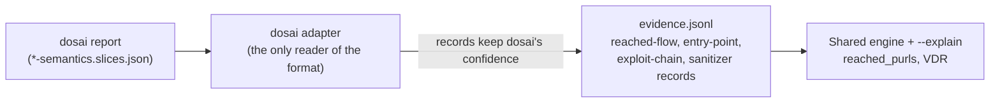

# .NET reachability with dosai

## Learning objective

After this chapter you will be able to run dep-scan reachability on a .NET project, explain how dosai's native report becomes evidence records, and predict which NuGet packages will be marked Reachable versus merely referenced. You will also know why a restored tree matters for versioned purls and how to choose between source and assembly inspection.

## What dosai is and when to use it

[dosai (Dotnet Source and Assembly Inspector)](https://github.com/owasp-dep-scan/dosai) is the native analyzer dep-scan uses for the .NET family (C#, VB, F#, R). It is shipped prebuilt via cdxgen-plugins-bin. dosai inspects source through Roslyn and assemblies through Reflection and IL, and it emits a call graph, interprocedural source-to-sink data-flow slices, explicit per-package reachability, weakness candidates, and dangerous-API reachability. The per-package reachability is the distinctive feature: each `PackageReachability` entry states `Reachable`, `ReachabilityKind`, `Confidence`, `EvidenceKinds`, and `SourceLocations`, which is strictly richer than a flow shape. dep-scan's dosai adapter reads the native report into the scan's evidence store: a reached package and each data-flow slice become `reached-flow` records that carry dosai's own confidence, and a slice record also carries the witness path dosai walked and the exploit chains that cover it, so the shared engine and the `--explain` renderer work off the native facts without an intermediate projection.

The practical effect is the same reachable-versus-present semantics every other language enjoys. A vulnerable NuGet package whose API is actually called (for example `Newtonsoft.Json.JsonConvert.DeserializeObject` on a controlled input) is marked Reachable, while a package that is merely referenced in a `.csproj` but never called is not. Reachability is on by default for .NET once the slices are present, so for most projects you scan with the research profile and read the Reachable insights.

## Prerequisites

dosai needs a .NET runtime to load, and the quality of purl attribution depends on the tree state.

- A .NET runtime, verified by `dotnet --version`. A self-contained `-full` dosai binary (from the [dosai releases](https://github.com/owasp-dep-scan/dosai/releases)) bundles the runtime and needs no SDK.
- cdxgen and dep-scan, installed by `npm install -g @cdxgen/cdxgen` and `pip install owasp-depscan`.
- The dosai binary, resolved automatically (see below) or supplied explicitly.
- A restored tree for the best versioned NuGet purls: `project.assets.json` and `*.deps.json` present. dosai falls back to versionless `System.*` framework purls otherwise.

## How dep-scan runs dosai

Under cdxgen's research BOM profile, which dep-scan selects when reachability is on, cdxgen runs dosai and persists the combined native report, containing `Metadata`, `methods`, and `dataflows`, to the `*-semantics.slices.json` path. dep-scan consumes that persisted report as the primary path and does not spawn dosai itself when cdxgen and the plugins are available. dosai is invoked directly only as a fallback, running `dataflows --pattern-packs all` and `methods`. dep-scan runs `dataflows` and `methods` with pattern packs set to `all`.

dep-scan resolves the dosai binary the same way cdxgen does. It checks the `DOSAI_CMD` environment variable, then `DEPSCAN_DOSAI_BINARY`, then `dosai` or `Dosai` on `PATH`, then the bundled `cdxgen-plugins-bin` layout at `<pluginsDir>/dosai/dosai-<platform>-<arch>` (a `binaryPath` in `plugins-manifest.json` takes precedence). `<pluginsDir>` is looked up in two steps. `CDXGEN_PLUGINS_DIR` is tried first when it is set. When it does not hold the binary, dep-scan uses the first plugins directory cdxgen would accept: `CDXGEN_PLUGINS_DIR` itself when it holds a `plugins-manifest.json` or a tool directory, and otherwise a `plugins` directory or `node_modules/@cdxgen/cdxgen-plugins-bin-<platform>-<arch>/plugins` in the install of the `cdxgen` command that `CDXGEN_CMD` or `PATH` resolves to (symlinks are followed). When cdxgen spawns, dep-scan propagates `DOSAI_CMD` and `CDXGEN_PLUGINS_DIR` to the subprocess so both sides use the same binary. If dosai cannot be found, .NET reachability is skipped with a warning and never a crash, and other languages are unaffected.

dep-scan probes `dotnet --version` and skips gracefully with a diagnostic when the runtime is absent. It does not run `dotnet restore` itself, because restore touches the network and the package source, which is unsafe on untrusted repositories; you are expected to restore before scanning.

## Example invocations

The hermetic fixtures under `test/data/dosai/repos/` let you reproduce the reachable-versus-present contrast offline. Both `reachable-app` and `unreachable-app` reference `Newtonsoft.Json 13.0.3`, but only `reachable-app` actually calls it.

```shell
# Reachable case: Newtonsoft.Json is referenced AND reached via a deserialization sink
depscan scan ./test/data/dosai/repos/reachable-app -o ./reports -t dotnet --bom-profile research --explain

# Point dep-scan at a specific dosai binary
DEPSCAN_DOSAI_BINARY=/path/to/dosai depscan scan ./test/data/dosai/repos/reachable-app -o ./reports -t dotnet --bom-profile research --explain
```

The control is `unreachable-app`, which references the same `Newtonsoft.Json 13.0.3` in its `.csproj` but never calls any Newtonsoft API.

```shell
# Present-but-unreachable case: package referenced, never called
depscan scan ./test/data/dosai/repos/unreachable-app -o ./reports -t dotnet --bom-profile research --explain
```

Reachability is on by default (`--reachability-analyzer FrameworkReachability`). dosai chooses how to inspect the target from what the path holds: Roslyn-based source inspection for C#, VB, F# and R sources, and Reflection and IL inspection for `.dll` and `.exe` files, including bin- or `.nupkg`-only inputs. There is no option to force one of the two. The `--dotnet-analyzer-mode` flag of dep-scan 6 was removed because dosai never had a matching switch.

### Exposure, exploit chains and sanitizers

When dosai 4.1 or later reports them, dep-scan keeps the exploit chains, the exposure tier of each entry point (`anonymous-http`, `authenticated-http`, `queue`, `cli` and so on), the sanitized flows and the service trust zones, all as evidence records. A slice dosai reached becomes a `reached-flow` record whose attributes name the exploit chains that cover it and its most exposed tier; an entry point becomes an `entry-point` record carrying the tier and the `trustZone` of its service; a chain becomes an `exploit-chain` record with its hop count, its route and its entry point id. A trace dosai sanitized becomes a negative `sanitizer` record: it never subtracts from the reached set, because dosai writes no flow for a trace it sanitized, so a flow that is present keeps its purls and its package stays reached.

Switch to `SemanticReachability` only when you also want reached services and endpoints attributed.

## Analysis walkthrough

Consider the `reachable-app` source. Its `Run` method takes a `TextReader input`, calls `input.ReadLine()`, and passes the result to `Newtonsoft.Json.JsonConvert.DeserializeObject<EchoRequest>(line)`. dosai recognizes the fully-qualified `DeserializeObject` call seeded by a method-parameter source as a deserialization sink. It reports the data-flow slices from `input` to that call, and it flags the package in a `PackageReachability` entry with `Reachable=true`, `ReachabilityKind=DataFlowNode` and `Confidence=High`. The dosai adapter turns each slice and the entry into `reached-flow` records, so `Newtonsoft.Json@13.0.3` lands in `reached_purls`.

The record below is the first of those slices, as the current dosai adapter builds it from the committed dosai 5.0.0 recording of the fixture (`packages/analysis-lib/tests/data/dosai/dosai-v5.0.0-reachable-combined.json`), with the `source` of a scan where cdxgen persisted the report. It is the complete record, spread over several lines for reading; in `evidence.jsonl` it is one compact line.

```json
{
  "schemaVersion": "1",
  "id": "ev-3842081af4aba8e0",
  "producer": { "name": "dosai", "version": "5.0.0.0", "reportSchemaVersion": "5.1.0" },
  "kind": "reached-flow",
  "polarity": "positive",
  "subject": { "purls": ["pkg:nuget/Newtonsoft.Json@13.0.3", "pkg:nuget/System.Runtime"] },
  "source": "dotnet-semantics.slices.json",
  "locations": [
    { "file": "Program.cs", "line": 10, "method": "Program.Run" },
    { "file": "Program.cs", "line": 11, "method": "Program.Run" },
    { "file": "Program.cs", "line": 11, "method": "Program.Run" },
    { "file": "Program.cs", "line": 12, "method": "Program.Run" }
  ],
  "caveats": [],
  "path": [
    { "file": "Program.cs", "line": 10, "method": "Program.Run", "symbol": "System.IO.TextReader input" },
    { "file": "Program.cs", "line": 11, "method": "Program.Run", "symbol": "System.IO.TextReader.ReadLine()" },
    { "file": "Program.cs", "line": 11, "method": "Program.Run", "symbol": "line" },
    { "file": "Program.cs", "line": 12, "method": "Program.Run", "symbol": "Newtonsoft.Json.JsonConvert.DeserializeObject(string)" }
  ],
  "confidence": "Medium",
  "attributes": {
    "sliceId": "dfs1",
    "exposure": "cli",
    "exploitChains": [{ "id": "ec1", "entryPointId": "ep1", "exposure": "cli", "hopCount": 1, "confidence": "High" }],
    "servicePurls": ["pkg:nuget/Newtonsoft.Json@13.0.3", "pkg:nuget/System.Runtime"]
  }
}
```

The record's witness `path` is the source-to-sink walk dosai reported, which is what `--explain` renders, and its `confidence` is the `Medium` the slice itself states. dosai reported the slice under the exploit chain `ec1`, from the command-line entry point `ep1`, so the attributes carry the chain and the `cli` exposure tier; the deserialization sink category puts the slice's purls in `servicePurls`.

The `PackageReachability` entry becomes a record of its own, with no path. It is shown here with seven of its eight locations left out, because all eight name line 12 of `Program.cs`:

```json
{
  "schemaVersion": "1",
  "id": "ev-716624baba007447",
  "producer": { "name": "dosai", "version": "5.0.0.0", "reportSchemaVersion": "5.1.0" },
  "kind": "reached-flow",
  "polarity": "positive",
  "subject": { "purls": ["pkg:nuget/Newtonsoft.Json@13.0.3"] },
  "source": "dotnet-semantics.slices.json",
  "locations": [
    { "file": "Program.cs", "line": 12 }
  ],
  "caveats": [],
  "confidence": "High",
  "attributes": {
    "kind": "DataFlowNode",
    "exposure": "cli",
    "exploitChainIds": ["ec1", "ec2", "ec5"],
    "servicePurls": ["pkg:nuget/Newtonsoft.Json@13.0.3"]
  }
}
```

Its `confidence` is the `High` the entry states, and the `kind` attribute keeps the `ReachabilityKind`. The same report also yields two more `Newtonsoft.Json` slice records, two slice records that name `System.Console`, the `PackageReachability` records of `System.Console` and `System.Runtime`, one `ExternalCallGraphNode` record per package from the methods half, and the `entry-point`, `exploit-chain` and `dead-code` records of the transparency sections.

Notice the versioned purl in the subject. That versioned purl is what the adapter's reconciler matches against the BOM component, and it is what makes the record count as evidence that the *affected* version is the one installed.

The contrast with `unreachable-app` is precise. That fixture references `Newtonsoft.Json 13.0.3` in its `.csproj` (and in its restored `.deps.json`) but its `Run` method only writes `line.ToUpper()` to the console and never calls any Newtonsoft API. dosai therefore produces no `PackageReachability` entry with `Reachable=true` for the package, at most a low-confidence Dependency-level reference, so `reached_purls` stays empty for `Newtonsoft.Json`. The package is present in the BOM and would appear in the full Vulnerability Disclosure Report, but it carries `depscan:prioritized=false` and no reachable insight, which is the triage signal to move on. This is the cleanest illustration of reachability value in the fixture set, because the two apps are identical except for the single call.

## The native report and the evidence store

It is worth being precise about the two artifacts, because .NET is the only analyzer that produces a native reachability verdict rather than just flows. The native `PackageReachability[]` is the reachability truth: dep-scan reads its `Reachable` flag, `ReachabilityKind` and `Confidence` as given. The dosai adapter is the only code that reads the native report's format; it writes what it found into `evidence.jsonl` as records that keep dosai's own confidence, evidence kinds and witness paths, and the engine counts the reached purls from those records (`reached-flow`, `usage` and `entry-point` records count; `dependency` records never do).

Which record an entry becomes follows a fixed rule. An entry dosai calls reachable becomes a `reached-flow` record when its kind is `DataFlowNode`, `DataFlowEdge`, `DataFlowSlice` or `CallGraphEdge` at Medium or High confidence, or `ExternalCallGraphNode` at High confidence. Every other reachable entry (the `Dependency` and `InternalCallGraphNode` kinds, any Low entry, any confidence other than Low, Medium or High) becomes a `dependency` record, and an entry dosai calls not reachable becomes a negative `no-path` record. A record's `confidence` is the one the entry states, exactly as stated. When an entry states none, the record has no `confidence`; the kind's default (High for the data-flow kinds, `CallGraphEdge` and `ExternalCallGraphNode`, Low otherwise) decides the counting alone, and the record names it in the attributes `confidenceSource: "kind-default"` and `confidenceDefault`. A stated confidence that is not text, such as a number, is kept in the `confidenceGiven` attribute instead and does not count. A slice record carries the confidence the slice states, when it states one.

dosai also writes `WeaknessCandidates` and `DangerousApiReachability` sections. The adapter makes no record from them, so they stay only in the native report.

In practice you read both: the records drive the console and the VDR, while the native report (in `*-semantics.slices.json` or under `analysis/dosai/`) is where you go for dosai's own words when you need to defend a verdict.



## Reading the artifacts

Three files in the reports directory tell the story. The `evidence.jsonl` at the top of the directory holds every record the adapters built; check here first if no package is Reachable, because a store whose dosai records carry no purls explains the silence, and the manifest's analyzer entry names the report that was looked for when dosai was not assessed at all. The `*-semantics.slices.json` cdxgen persisted carries the combined native report, both halves with their `PackageReachability[]` entries, which is the authoritative source for confidence and evidence kinds. When dep-scan ran dosai itself, the two halves are separate files: `analysis/dosai/dotnet-dataflows.json` holds the dataflows half (the slices, exploit chains, attack surface and sanitized flows) and `analysis/dosai/dotnet-methods.json` the methods half (the call graph, API endpoints, services and dead code). The `<base>.vdr.json` carries the `depscan:prioritized` property and the `depscan:insights` text ("Reachable", "Endpoint-Reachable") per vulnerability; filter the `vulnerabilities` array on those properties to reconstruct the prioritized set, as described in the [VDR guide](../output/vdr-guide). When you generate a VEX document with `--csaf`, a reached package becomes `known_affected` while a package that was not observed on a reached path stays `under_investigation`, as covered in the [CSAF VEX guide](../output/vex-csaf-guide).

## Troubleshooting

If dosai reports that the .NET runtime is missing, install a runtime or switch to a self-contained `-full` dosai binary from the dosai releases. If slices are generated but packages are Reachable with versionless `System.*` purls, the tree was not restored; run `dotnet restore` (on a trusted tree) before scanning so dosai can attribute versioned NuGet purls. If dosai does not flag an expected deserialization sink, check that the call is fully qualified (`Newtonsoft.Json.JsonConvert.DeserializeObject` or `System.Text.Json.JsonSerializer.Deserialize`) and seeded by a method-parameter source; the dosai fixture README documents that unqualified calls relying on a `using` directive do not reliably bind the sink symbol in minimal projects. The existing [dotnet-podcasts framework analysis lesson](../Lessons/dotnet-framework-analysis) complements this chapter with a larger public-project walkthrough.

## Summary

dosai gives .NET the same reachable-versus-present semantics every other language enjoys in dep-scan, with the added precision of an explicit native reachability verdict per package. The `reachable-app` fixture shows `Newtonsoft.Json@13.0.3` marked Reachable with high confidence because `JsonConvert.DeserializeObject` is called on a controlled input, while `unreachable-app` shows the same package merely referenced and therefore never reached. Restore your tree for versioned purls, and read the prioritized set from the VDR or the CSAF status from the VEX. The neighboring chapters [Rust reachability](rust-reachability) and [Go reachability](go-reachability) cover the other native slicers, the [Framework reachability](../analyzers/framework-reachability) chapter explains the engine these slicers feed, and the compliance story continues in the [VDR guide](../output/vdr-guide) and [CSAF VEX guide](../output/vex-csaf-guide).
