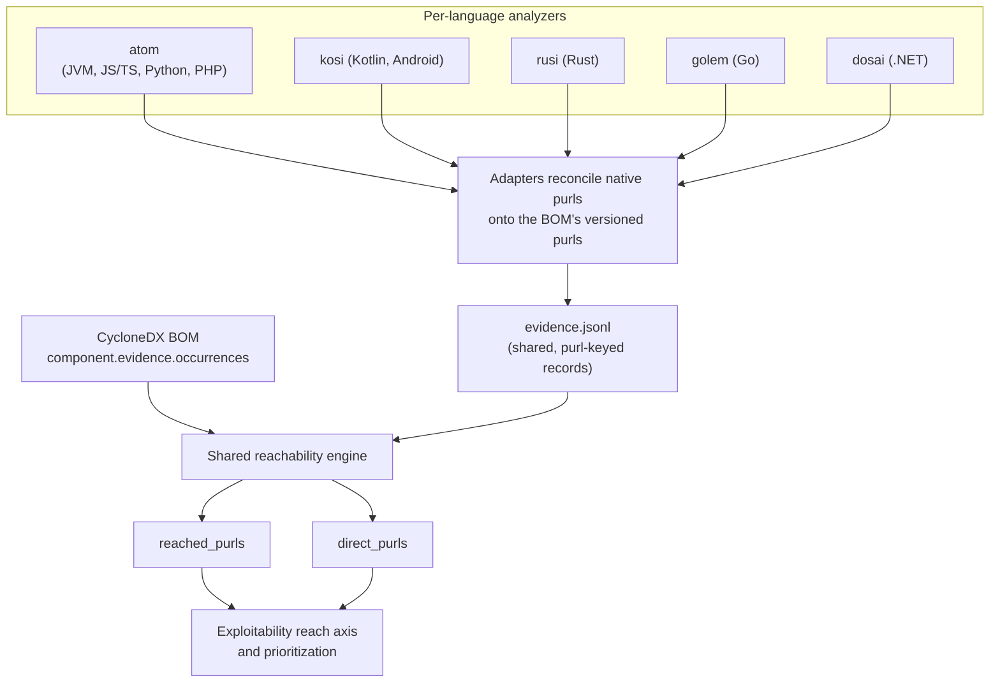

# The reachability model

The question behind every reachability report is whether a vulnerable package is actually used. A dependency that is declared in a manifest but never called is *present*; one whose functions sit on a path that starts at a real entry point is *reached*. The difference is the difference between "upgrade this someday" and "upgrade this now", and severity alone cannot supply it.

dep-scan computes the reachable flows for the project first, from the source and the inventory, and intersects that set with the advisory data afterwards. A package is reached whether or not an advisory mentions it, so when a new advisory lands the existing reachability picture already answers it.

## Present and reached

The engine keeps two purl-keyed maps, and the difference between them is the vocabulary of every report:

- `direct_purls` comes from the `component.evidence.occurrences` on the BOM, where cdxgen records that a dependency appears in code: an import, a require, a using directive. A purl there is referenced in source, not merely declared in a manifest.
- `reached_purls` comes from the subject purls of the reached records in the evidence store: a purl lands there only when a producer traced it from a real entry point.

Findings carry the result as the reach axis of [the exploitability assessment](exploitability): `likely` for a package in a covering analyzer's reached set, `unknown` for one the analyzer covered and did not reach, `not_assessed` when no analyzer covered it, and `proven` reserved for function-level reach once the advisory names the affected function and vdb's metadata tables make it matchable.

## Two layers, one record shape

The first layer is a per-language analyzer that reads the source (and, for .NET, the assemblies) and writes its own report: call graphs, data-flow slices, entry points, each with package attribution. Five analyzers cover the seven ecosystems: atom for Java and the JVM, JavaScript and TypeScript, Python and PHP; kosi alongside atom for Kotlin and Android; rusi for Rust; golem for Go; dosai for .NET. The second layer is the shared, purl-keyed engine that reads the evidence store and counts the reached purls. Each producer has one adapter, the only code that knows that report's format, and the adapter's central job is the purl reconciler: native tools often emit versionless purls, which are mapped by name onto the BOM's versioned purls so a flow can prove that the *installed* version is the affected one.

Because every adapter normalizes to the same record shape, a Java atom record and a Go golem record are indistinguishable to the engine, the explainer and the MCP tools. A record that states `Low` confidence never counts as reached, whatever its producer: dep-scan keeps the record with its stated confidence but adds no purl to the reached set and lets it witness no finding.

## The two analyzers

`--reachability-analyzer` selects how far past the reached set the scan goes:

| Value | What it computes | When to use it |
| --- | --- | --- |
| `FrameworkReachability` | Reached purls from the analyzer reports, plus direct uses from the BOM's occurrences. | The default. Answers "is the vulnerable package called". |
| `SemanticReachability` | Adds endpoint reachability (OpenAPI usage targets mapped to occurrences), service reachability (packages that talk to allow-listed services) and post-build reachability (framework and crypto components across lifecycle BOMs). | When "called" is not enough and "callable from the network" is the question; needs the lifecycle inputs the [semantic analyzer section](../targets/source-repositories#the-semantic-analyzer) describes. |
| `off` | No reachability at all. | A plain version-based scan. |

A universal scan (the default for a source tree) starts no language tool by itself under the framework analyzer, because a full-tree analysis can outlast the rest of the scan; it starts one under the semantic analyzer when the BOM carries that language's purl type. A typed scan (`-t go`, `-t dotnet` and so on) starts the matching tool whenever reachability is on. Where the tool's report is missing, the manifest's analyzer entry says so with the reason, and the reach axis stays `not_assessed`; it never reads as "not called".

The [source repositories page](../targets/source-repositories) shows how to turn reachability on per language and what each one needs installed.
